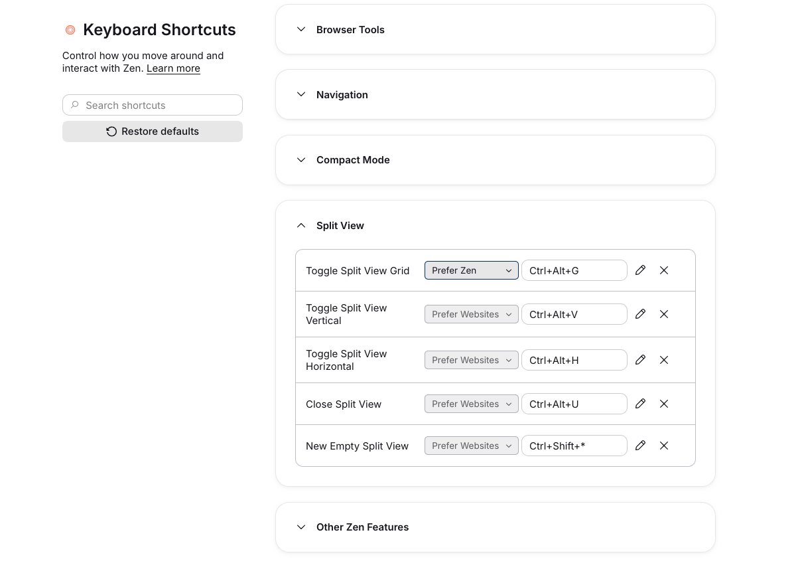

# Shortcut Priority

Arc's per-shortcut conflict setting, for Zen. Every shortcut in Zen's Keyboard Shortcuts settings gets a picker that decides what happens when a website also uses that key:

| Option | What happens |
| --- | --- |
| Prefer Websites | The website gets the key first. If it handles it, Zen does nothing. |
| Use Both | The website gets the key, and Zen runs its shortcut too. |
| Prefer Zen | Zen runs its shortcut, and the website never sees the key. |

Pickers you've changed are outlined. Ones you haven't show what the shortcut does out of the box: most are Prefer Websites, while a few (new tab, new window, close tab, quit and similar) are Prefer Zen. Picking the out-of-the-box option clears your setting.

Built and tested against Zen 1.24b.

## Install

1. In Zen, open Settings → Sine Mods.
2. Install from `https://github.com/pbroom/shortcut-priority`.
3. This mod runs a script, so non-store installs need `sine.allow-unsafe-js` set to `true` in `about:config`.

Then open Settings → Keyboard Shortcuts (`about:keyboard`). Turning the mod off puts every shortcut back the way Zen ships it, without a restart.

## Tab switcher

The mod adds **Tab Switcher (forward)** and **Tab Switcher (backward)** to the Window section of `about:keyboard` (View on platforms without a Window menu). Assign the keys there and choose their priority using the same picker as every other shortcut. They start unassigned, so installing the mod does not replace your existing bindings.

For an Arc-style setup on macOS:

1. Clear **Go to Tab 1** if you want to reuse Command+1.
2. Assign **Tab Switcher (forward)** to Command+backtick and **Tab Switcher (backward)** to Command+1.
3. Hold Command while pressing either key to cycle through the native recent-tab previews. Release Command to select. Ctrl+Tab continues to work.

macOS normally reserves Command+backtick for **Move focus to next window**. Overriding it inside Zen requires the companion native Zen/Gecko backport; stock Zen 1.24b consumes the key before this mod receives it. With that backport, choose **Prefer Zen** for the switcher action to request native priority. The mod leaves global macOS shortcuts unchanged. **Prefer Websites**, **Use Both**, and disabling the mod withdraw this request, so macOS can retain reserved combinations. Other key combinations work on stock Zen.

The switcher uses Zen's existing preview list and pending-tab rules. It skips the Show All Tabs button while cycling, and creates no separate tab history or preview UI. Disable the Sine mod to remove its actions and menu items; Zen retains your custom bindings for re-enabling it.

## Options

In the mod's settings in Sine Mods, or under `zen.shortcut-priority.*` in `about:config`.

| Pref | Default | What it does |
| --- | --- | --- |
| `zen.shortcut-priority.enabled` | `true` | Turns the mod on or off |
| `zen.shortcut-priority.default` | `default` | What shortcuts you haven't set use: `default` (Zen's own behavior), `websites`, `both` or `zen` |
| `zen.shortcut-priority.rules` | `{}` | Your per-shortcut choices, as JSON (`{"key_id": "zen"}`). The picker writes this. |

## How it works

Zen 1.24 moved its shortcuts to Firefox's `about:keyboard`, where each shortcut is a `<key>` element. Gecko already has the switch Arc's setting needs: a key marked `reserved="true"` never reaches the page's own key listeners, and one marked `reserved="false"` lets the page cancel it with `preventDefault()`.

- **Prefer Zen** sets `reserved="true"`. **Prefer Websites** sets `reserved="false"`. Gecko only reads key elements when their keyset is attached, so the script re-attaches changed keysets, the same way Firefox applies edited shortcuts.
- On macOS, the switcher keys also carry `data-native-shortcut-priority="true"` while enabled and using **Prefer Zen**. The companion native patch checks that opt-in on a reserved chrome key before AppKit's default shortcut handling. Stock Zen ignores the attribute. Other shortcut actions are not opted in.
- **Use Both** keeps the key unreserved so the page gets it, runs Zen's command itself as soon as the key is pressed, and cancels the copy of the event the page process sends back so the command doesn't run twice.
- The picker is added to `about:keyboard` by a small frame script, because that page runs in Firefox's privileged about: process rather than the browser window.

## Verification

Run `npm test` (Node 22 or later). The tests exercise priority rules, event forwarding, native switcher actions, modifier release, and unload cleanup with a browser harness. They do not prove macOS shortcut delivery; verify configured keys in a running Zen as well.

## License

MIT
